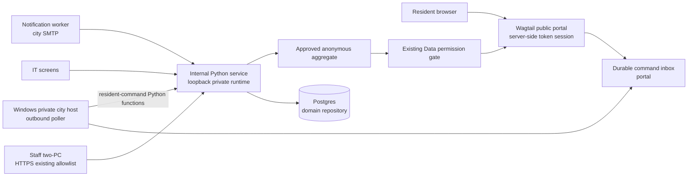

# Townlight311 — Proposed UI and Contract Design

**Status: proposed design.** This document describes intended UI, contracts, and acceptance cases. It is not execution evidence and does not assert that tests, deployments, or migrations have run.

## Scope

Townlight311 is a Windows-only module for existing local government staff and residents. Existing staff roles are unchanged: `local-admin`, `city-staff`, `clerk`, `records-staff`, and `code-staff`. No new staff roles or prototype boundaries are introduced. One final signed candidate is planned after code verification.

The private runtime is a loopback-bound native FastAPI service with Rustbridge integration and existing permissions. Staff use two-PC HTTPS with the existing allowlist. The Wagtail public portal is separately deployed. The portal has no desktop runtime and cannot call Rustbridge or the private runtime directly. Resident tracking tokens remain server-side in the Wagtail session.

## Roles and access

| Role | Access summary |
|---|---|
| Resident | Public portal screens only, through a server-side session token. |
| `local-admin` | Existing configuration and administration permissions, including Townlight311 configuration. |
| `city-staff` | Townlight311 operations as already defined. |
| `clerk` | Intake, triage, and updates only through an explicit new Townlight311 module permission. This grant does not blanket-access existing modules. |
| `records-staff` | Existing Records access only. No Data access and no general Townlight311 queue access. |
| `code-staff` | Existing Code access only, plus explicitly authorized links. No automatic Townlight311 private-record access. |

Townlight311 operations are limited to `local-admin` and `city-staff`, with `clerk` also allowed intake, triage, and updates as stated in the permission matrix. This clerk grant does not blanket-access existing modules. Permissions are enforced server-side; UI hiding is not authorization. No new staff roles are created.

A private resident-authenticated projection may contain the resident’s own description and location. Anonymous approved aggregates cannot contain resident identity or exact-location fields: resident names, email addresses, phone numbers, exact addresses, account identifiers, internal notes, staff identities, token material, and private runtime identifiers. Public aggregate data requires approval first, then passes the existing Data permission gate. Records access alone does not authorize Data or public aggregates.

## Resident screens

Resident screens: **category**, **photo**, **location**, **contact**, **secure tracking and recovery**, **comment**, and **reopen**.

- **Category:** required selection from configured public categories. Inactive categories are disabled and labeled. Validation: exactly one valid category.
- **Photo:** optional or required per category policy. Accept validated image types and bounded size. Show upload progress, remove, and retry. Errors state file type or size failure without revealing server paths.
- **Location:** required text or address selection per policy. Validate non-empty, bounded length, and permitted characters. Location is private; it may appear only in the resident-authenticated view and is not shown in anonymous public projections or approved aggregates. Show required consent language.
- **Contact:** required contact channel as configured. Validate email shape and phone format; normalize but do not publish. Contact data is private. Show required consent language.
- **Secure tracking:** show the public tracking reference only after the portal durably accepts the command. The resident tracking token stays server-side in the Wagtail session; it is never placed in URLs, client storage, logs, or public HTML.
- **Tracking recovery:** because tracking is session-only, a resident who loses the session may request a single-use emailed access code with a short TTL and rate limits. A valid code binds a new server-side session. Raw resident bearer tokens are never exposed in URLs or logs.
- **Comment:** optional or required per policy, bounded plain text. Field-level and summary validation errors.
- **Reopen:** available only when policy permits and the resident session is authorized for that request. Require a reason and preserve history.

Resident states: loading, empty categories, inline and summary errors, success with public reference, expired session, recovery, and retry for transient failures. Accessibility targets WCAG 2.2 AA: keyboard operation, visible focus, labeled controls, linked error summaries, sufficient contrast, meaningful alt text, and no color-only status.

## Staff screens

Staff screens: **category config**, **queues**, **triage**, **assign**, **transfer**, **status**, **duplicates**, **resolve**; Records **archive**; approved **aggregate data**; IT **email transport**, **portal setup**, and **backups**.

- **Category config:** list/create/edit/activate/deactivate. Validation: unique name, required fields, and no deletion that would orphan records. Configuration permission is limited to `local-admin` and existing authorized configuration staff.
- **Queues:** filter by category, request state, assigned staff, age, and area label. Pagination, stable sort, loading, empty, and error states. Private contact fields are masked unless the role and screen require them.
- **Triage:** set priority, category, and state with allowed transitions. Validation: legal transition for current state, version/hash check, and optimistic concurrency.
- **Assign:** choose active authorized staff. Assignment is audited.
- **Transfer:** move to another queue, category, or team with a reason. Target must be valid and active.
- **Status:** controlled vocabulary with allowed transitions. Reject stale updates using version or ETag checks.
- **Duplicates:** link or unlink suspected duplicates. A record cannot link to itself; linking preserves both records; unlink requires permission and reason.
- **Resolve:** close with required resolution code and notes. Validation: required fields, legal transition, version/hash check, and idempotent command key. No queue-closure prerequisites are added.
- **Records archive:** existing Records-authorized staff only. List archived records and immutable archive metadata. Archive only eligible records; no silent mutation.
- **Approved aggregate data:** only pre-approved metrics. Authorization passes the existing Data permission gate after approval. Results are aggregate-only, with no row-level identity or exact location.
- **IT email transport, portal setup, backups:** configure city SMTP transport, portal connection settings, and view backup status through existing mechanisms. Secrets are never displayed after entry or written to logs. Backups reuse the existing mechanism; no new backup scheduling feature is added.

Global staff states: loading, empty, permission denied, validation summary, conflict or stale update, service unavailable, and retry. Tables include captions, sortable-header announcements, and dialog focus management.

## Request states

Request states are exactly: `submitted`, `triaged`, `assigned`, `in_progress`, `resolved`, `closed`, `rejected`, `duplicate`, and `reopened`.

Allowed transitions are permission- and policy-checked:

| From | To |
|---|---|
| `submitted` | `triaged`, `rejected`, `duplicate` |
| `triaged` | `assigned`, `rejected`, `duplicate` |
| `assigned` | `assigned` (transfer), `in_progress`, `triaged`, `duplicate` |
| `in_progress` | `resolved`, `assigned` |
| `resolved` | `closed`, `reopened` |
| `closed`, `rejected`, `duplicate` | `reopened` |
| `reopened` | `triaged`, `assigned` |

Stale transitions are rejected. Reopen preserves prior history and creates a linked mutation.

## Architecture and contracts

Postgres stores domain records. FastAPI with Rustbridge enforces existing permissions for staff. Staff access is two-PC HTTPS with the existing allowlist. The Wagtail portal is separate and never exposes private runtime details.

**Host channel:** The Windows private city host makes outbound HTTPS requests to the city Wagtail portal, and the bearer is verified by the portal. The public host never calls the native/Rustbridge service. No allowlisted network path is required for the host channel.

**Durable portal inbox:** The portal durably stores each resident-originated command before acknowledging it. The inbox operation allowlist is ONLY resident create, track, comment, reopen, and attachment; no arbitrary path operations and no staff commands are accepted. A command includes operation, payload, public reference, idempotency key, command ID, and expected hash. The acknowledgement response includes the command ID and expected hash. The client displays **queued** until the host acknowledges processing; it must not claim the request is submitted.

**Host poller:** An authorized Windows private city host poller claims commands over outbound HTTPS using a claim lease. It executes internal Python service functions under explicit resident-command scope; it makes no Rustbridge call and does not impersonate staff. The private runtime remains loopback-bound. Results are acknowledged idempotently. The portal never calls Rustbridge or the private runtime.

Command states: `queued`, `claimed`, `processing`, `succeeded`, `failed`, `dead_letter`. Claim leases expire; processing is at-least-once. Idempotency and claim leases apply to resident inbox commands, including request creation, comments, reopen, and attachments. Staff mutations use version/ETag checks as described. Duplicate idempotency keys return the existing result.

**Attachments:** compute SHA-256 at intake; store hash and size; verify on delivery. The receiver-confirmed RecordsID is assigned only after the receiving records system confirms acceptance. Until then, use a provisional reference. Public tracking shows only the approved public reference.

**Notification worker:** schedules notifications using city SMTP configuration. Credentials come from protected configuration and are never logged. Logs contain event, result category, and correlation ID only. Retries are bounded and idempotent. The worker reports SMTP accepted versus delivered only when the transport supplies that distinction. It does not promise confirmation or read receipts, which SMTP does not provide.

## Acceptance cases

1. **Complete workflow:** resident submits category, photo, location, contact, and comment; portal durably queues the command; host acknowledges; staff triage, assign, transfer, update state, resolve; Records archives; receiver confirms RecordsID. Anonymous public projections and approved aggregates contain no private identity or exact-location fields; the resident-authenticated view may show the resident's own description and location.
2. **Wrong token and privacy:** invalid, expired, or missing resident session tokens are rejected. Internal runtime identifiers, private fields, SMTP credentials, host details, and raw bearer tokens are absent from responses, logs, and public HTML. Recovery uses a single-use emailed access code with TTL and rate limits.
3. **Duplicate, reopen, and concurrency:** duplicate idempotency keys return one result. Reopen preserves history and policy checks. Concurrent staff updates using stale versions are rejected with a conflict state.
4. **Host restart:** queued commands survive portal restart. Claimed commands recover after lease expiry. Result acknowledgement is idempotent. No duplicate records are created.
5. **Aggregate approval:** a public aggregate is approved first and then authorized through the existing Data permission gate. Records-only access cannot publish it. Anonymous approved aggregates contain no exact-location fields.
6. **Backups:** the existing backup mechanism runs and reports status; credentials are not logged; backup metadata is visible only to authorized IT roles. No new backup scheduling feature is introduced.

