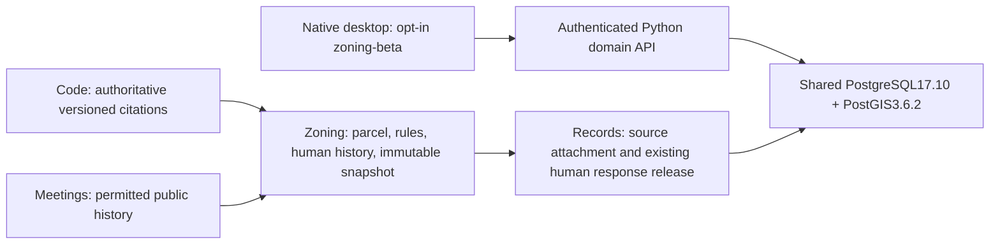

# Connected Records–Meetings–Code–Zoning: Z4 local acceptance

Candidate: desktop1.4.0-1 / MSI ProductVersion1.4.0.1, unsigned and unpublished.
Status: corrected packaging, fresh installation, populated upgrade, recovery
and retained-data uninstall PASS. Both owned Sandbox guests are closed.

Corrected MSI SHA256:
`c384e7d2b1387b05a30bc6c39a4b9a106ce51405a5976a451c55a4e434104909`.
Inner EXE SHA256:
`7b7f3166ca4974cdc4fb8d4ead2d3d554c4669d14964242b11cd9ceccf1d4df4`.
Candidate bytes are unsigned and PublicationAllowed=false.

## Connection and deployment boundary

No new Rust domain logic, second data authority, model download or whole
land-use activation. Records default, previous profile selections, legacy
installer UpgradeCode and retained data paths remain unchanged.

## Evidence ledger

- Payload preparation and real embedded Python imports: PASS.
- Canonical catalog and installer/public-status projection checks: PASS.
- Affected native module registry:14tests PASS.
- Existing frontend static/XSS/state/client checks: PASS.
- Application compile: PASS,26 existing dead-code warnings.
- Installer: corrected compile/link and exact-byte installed acceptance PASS.
- Fresh connected workflow, offline restart/new operation, backup/restore,
  repair, public/staff protection and retained-data uninstall: PASS.
- Populated1.3upgrade and post-upgrade Zoning/recovery: PASS. Saved city-core
  selection retained; explicit zoning-beta opt-in, three-source Records export,
  independent exported-file checks, SQL/files restore and Code/Meetings/Zoning
  history/hash preservation passed. Upgrade MSI exit0, one registered product.
- Upgrade uninstall exit0, product removed/user data retained PASS. Owned
  upgrade guest released October21,2026 at00:27:57MDT; fresh guest was already
  released00:06:39MDT. No background resource reservation remains.

Upgrade operator requirement: stop City workflow services and Task queue, then
PostgreSQL before Repair refreshes the changed PostgreSQL/PostGIS payload.
Repair while PostgreSQL was running failed on locked icudt67.dll; the failure
is retained as upgrade/repair-live-lock-failure.json. Actual UI stop followed
by Repair passed without deleting data or altering the candidate. This is not
an unattended-upgrade claim. The manual documents this sequence.

Fresh evidence: z4-local/fresh includes actual setup/activation reports,
three-source Records response and immutable Zoning history, independent export
file/manifest hashes, recovery proof (later test mutation removed), zero guest
default-route count, native unauthenticated/public denials and MSI uninstall
exit0 with program removed/user data retained. The fresh Sandbox was closed
before opening the separate upgrade guest.

Provenance investigation: an initial loose-EXE expectation failed. Independent
extraction of File Id Path from the exact MSI matched the installed EXE. A full
binary comparison isolated ONLY the three-byte bundle-type tag: MSI inside
the installer versus UNK in the loose build output. No application behavior
differs; exe-bundle-tag-comparison.json records normalized-byte equality.
Installed/export verification then passed using the independently extracted
MSI-inner hash. No new candidate or blind hash adjustment was used.

The cleanup helper's final service-stop attempt encountered the existing
maintenance guard after Python/Postgres consumers were stopped. That helper
failure is retained; the separate MSI removal/data-retention check passed.

The first linker attempt exposed generated Python bytecode paths beyond WiX's
limit. A verbose link isolated the exact file. Only regenerable __pycache__
directories inside the disposable payload were removed; unchanged application
bytes were relinked without another compiler build. Original sources,
earlier evidence and signed1.3baseline are preserved.

Initial installed testing exposed omitted zoning-beta display conditions for
Records' existing Meetings/Code source panels. Both were corrected together,
existing static guards extended and frontend checks passed. A corrected MSI
was built; rejected bytes/results are preserved and are not acceptance proof.

## Full-spec limits and release boundary

This increment does not deliver live ArcGIS/assessor/CKAN ingestion, a GIS
editor, AI interpretation, binding zoning determinations, Planning/Permitting,
or a production-scale spatial benchmark. No production performance claim is
inferred from the small fictional dataset. Human answers and source snapshots
are explicit, audited operations; attaching is not approval or publication.

All implementation is local. Remote required CI cannot be claimed without
the separately authorized push. Zone has local DCO commit
3e4413c35c213b036c431a8949e2bfa011c8c1d4. Both desktop CI jobs now check out that
exact Zone commit and prepare zoning-beta; YAML parsing and the affected static
guard passed locally. The Zone commit has NOT been pushed, so remote checkout
is not yet available. Townlight/Sunshine changes remain local and require final
release commits/pins and authorized required CI before signing/publication.
The accepted MSI was not rebuilt for CI/docs-only edits. Its provenance records
the packaged source separately from subsequent release-preparation edits.

Runtime preparation now removes regenerable __pycache__ directories only within
its resolved Python payload boundary before generating the lock. Script parsing
and an isolated cleanup/retained-source check passed. This prevents recurrence
of the diagnosed WiX path failure; no extra installer rebuild was needed.

No push, merge, sign or publish is authorized in Z4. The public1.3release and
landing page are not changed by this local documentation.
