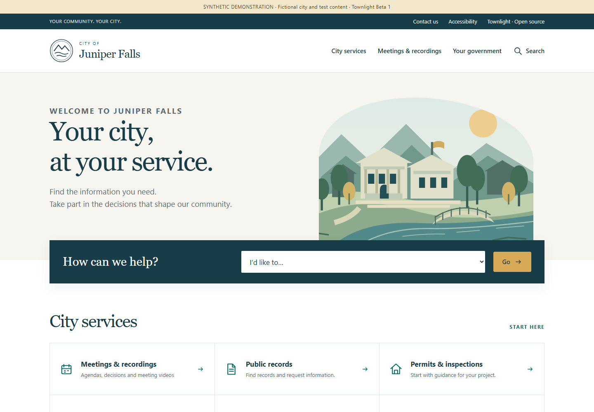
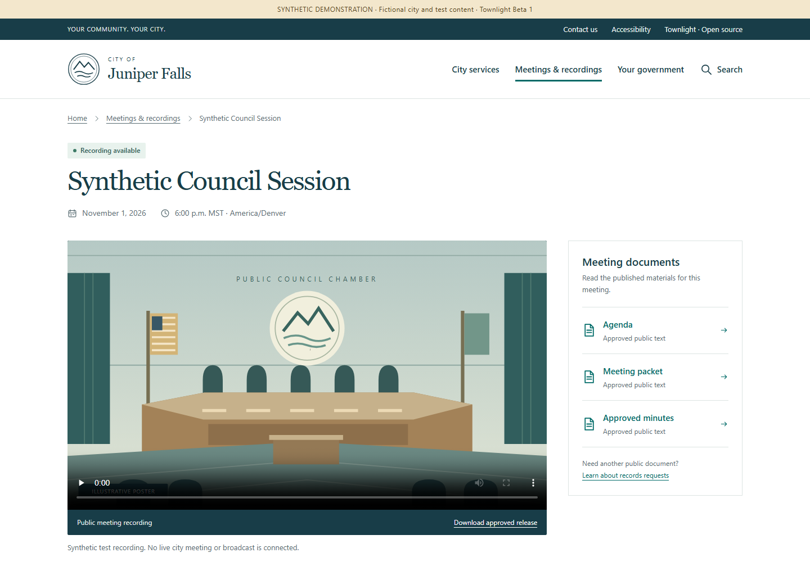
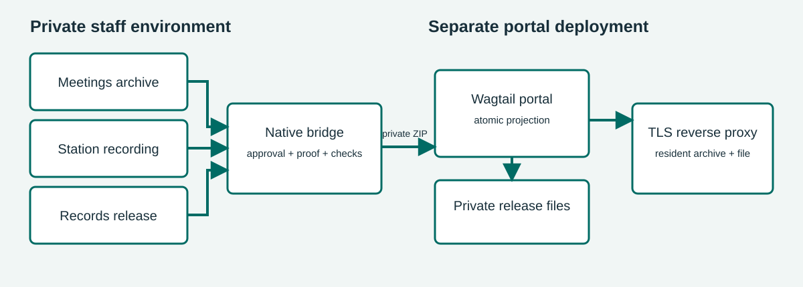

# Townlight Portal guide

Townlight Beta 1 · separately deployed portal beta

The portal is a separately deployed suite capability for city pages and public meeting archives. It brings together a public Meetings archive, a completed Station recording and a Records release copy selected for publication. It does not add a tenth product. The existing signed Beta 1 installer and prior Sandbox evidence predate this local portal integration; they do not demonstrate that it is installed or publicly deployed. CivicCast remains separate.

## For staff: prepare and publish

1. In Meetings, publish the intended non-closed meeting archive. Review its title, scheduled time, agenda, packet, minutes and summary for public use.
2. Complete the corresponding Station recording and the Records request and release workflow. Records must have a current approved response, completed verified artifacts, a fulfilled request and an eligible managed release copy with verified lineage to that recording. Keep the original private.
3. Obtain the Records request UUID from the trusted staff workflow. A fulfilled request or prepared copy is not consent to publish.
4. A Wagtail superuser opens **Townlight publication** in `/admin/`, enters the request UUID, selects **Find approved releases**, and chooses the intended result. The form fills the archive, meeting, recording, request and release-copy IDs and expected SHA-256; approval remains unchecked. Review the selection and public content, select **Publish or update**, and explicitly approve. Confirm the resulting meeting page and approved file as a resident would. Ordinary Wagtail editors cannot use this publisher.
5. To remove it from the public archive, use the same selection and hash, choose **Withdraw**, and explicitly approve. Verify that the meeting and file are no longer accessible. Withdrawal hides the projection; retain source records and follow local retention policy.

An unsuccessful synchronization leaves the previous publication intact. Repeating a successful publication updates the same archive identity. If source records change, review and explicitly publish again; do not assume a source error withdraws a prior version.

## Residents



The meeting archive is at `/meetings/`. A published meeting page at `/meetings/<pk>/` presents the approved public meeting text and links to its release at `/meetings/<pk>/release/`. The approved release bytes are served with the selected MIME type and support byte ranges for video playback. Public text is filtered; requester contact information, internal notes, raw payloads, local paths and session proof are not public fields. This integration is for completed release copies, not live YouTube streaming. Station's separate CivicCast and YouTube workflows retain their own controls.

The city-branded homepage presents a resident task finder, service information and the latest published playable recording when one is available. The archive offers upcoming, past and all dates, title search, a meeting-series selector and 20 results per page. Meeting series uses the actual public title: the source contract does not supply a separate board taxonomy. Each date uses that meeting's configured IANA time zone. Cancelled entries remain identifiable, with no offered playback or documents.



On a native Townlight meeting, open **Agenda**, **Meeting packet** or **Approved minutes** to read the actual approved text in a separate printable page. These are text documents, not invented PDF attachments. Video controls play the approved release; **Download approved release** retrieves the same checked bytes. Expand **About this public record** for provenance IDs, hashes and precise timestamps. PrimeGov fixtures instead identify their links as synthetic references; they do not imply live vendor downloads or playable media.

**Search** matches published service-page titles and published meeting titles only, with at most 50 results of each type. It excludes drafts, restricted city pages, withdrawn meetings and private staff content. It does not search the bodies of documents, external systems or private Records requests. Service buttons name the destination host before taking a resident to the city's configured existing service. Applications, requests and payments stay in that designated system. Navigation, the task finder and filters work without JavaScript; JavaScript enhances the mobile menu.

## City editors: branding and service content

1. Open the home page in Wagtail. Set **Brand name**, **Brand prefix**, the optional city **Logo** and **Hero image**, the **Hero title**, introduction, address and hours. Uploaded imagery must be approved for public use. With no uploaded images, the original generic civic emblem and illustrations are used. The page title is the fallback brand name; `TOWNLIGHT_BRAND` remains the administrative site-name/fallback setting. Existing versions stay unchanged and the suite label is **Townlight Beta 1**.
2. Create or edit a **Service page** under the home page. Set its title, kind, summary, section heading and body. Enter one next step per line. Optional question/answer blocks become expandable common questions. Set the department and public contact details where relevant.
3. For a handoff, enter the designated HTTPS **Destination URL** and clear **Destination label**. Addresses containing credentials and non-HTTPS schemes are rejected. The resident sees the destination host. This field is a link, not a vendor connector or new portal transaction. Verify it against the city's authorized service before use.
4. Page kinds determine icons and shared links. `records`, `permits`, `code`, `planning` and `contact` are resident service entries. `government` supplies the government navigation link; `privacy` and `accessibility` supply footer/utility links. Only live, public pages appear. Use Wagtail's existing editor submission and moderator approval workflow; editing a draft does not update public pages.
5. Review the public home, service page and phone layout after publishing. Unpublishing or restricting a page removes it from navigation, the task finder and title search. Configure city-approved privacy, accessibility and contact content; the fictional demonstration's notices are examples, not an adopted city's policies.

`setup_demo` creates the fictional **Juniper Falls** homepage and eight information pages on a fresh portal. The persistent synthetic notice is controlled by the home page's **Synthetic demo** field. Example service destinations use reserved `.example` domains and do not operate real services. Repeating the command preserves any existing Townlight home and its editorial content; it does not replace a city's website. Existing deployments receive additive fields through `migrate`; no existing text is overwritten. Configure their home and service pages through Wagtail after migration.

No resident account framework, official fee calculation, payment processor, live-stream host or new vendor integration is introduced by this interface.

## Deployment and setup

The portal is a separate Wagtail deployment with its own database. Keep the native desktop runtime bound to loopback; do not expose it to the internet. Arrange a trusted private connection between the portal service and native runtime. The bridge accepts HTTPS origins or loopback HTTP origins; it does not follow redirects or use environment proxies. Restrict the server-side proof file to the portal service account and provision a native principal with both Meetings and Records permissions. Never put the proof in a browser, selection file, log or public document.

From the `portal` directory, use Python 3.13, install `python -m pip install --require-hashes -r requirements.lock`, run `python manage.py migrate`, `python manage.py setup_demo`, and `python manage.py createsuperuser`. For local evaluation run `python manage.py runserver 127.0.0.1:8000`. Set a unique `TOWNLIGHT_SECRET_KEY`, `TOWNLIGHT_DEBUG=0`, allowed hosts, TLS and appropriate static and media service before deployment. `TOWNLIGHT_DB` selects the database path; `TOWNLIGHT_BRAND` selects the site name. Protect the database and the private release directory together. `TOWNLIGHT_RELEASE_ROOT` is an absolute private directory outside public media; by default it is `private-releases` under the portal directory. These setup steps do not commission a hosted site or alter the already released installer.

Set `TOWNLIGHT_NATIVE_ORIGIN` to the trusted native origin and `TOWNLIGHT_NATIVE_PROOF_FILE` to an absolute private proof-file path. Sign in to the active native desktop with an account authorized for both modules. The active profile's `config/local-session.json` contains `session_hash`; this is an active session proof, not a durable service token. Copy it without displaying it into an absolute file in a directory already restricted to the portal service account. Replace both placeholders in this PowerShell command with the actual private paths:

```powershell
[System.IO.File]::WriteAllText('<protected-absolute-path>\portal-proof.txt', (Get-Content -LiteralPath '<active-profile>\config\local-session.json' -Raw | ConvertFrom-Json).session_hash, [System.Text.UTF8Encoding]::new($false))
```

Refresh the protected proof after session expiry, sign-out, account change or credential change. Do not print or publish it. `TOWNLIGHT_DISPLAY_TIMEZONE` is an IANA time zone, defaulting to `UTC`. A private selection file can drive the same operation from the portal directory:

```json
{"action":"publish","approve_publication":true,"archive_id":"00000000-0000-4000-8000-000000000001","meeting_id":"00000000-0000-4000-8000-000000000002","recording_id":"00000000-0000-4000-8000-000000000003","request_id":"00000000-0000-4000-8000-000000000004","release_copy_id":"00000000-0000-4000-8000-000000000005","expected_release_sha256":"0000000000000000000000000000000000000000000000000000000000000000"}
```

These IDs and hash are placeholders. Run `python manage.py sync_townlight selection.json`. For withdrawal change `action` to `withdraw`, retain the selection fields and explicit approval, and verify removal. Restrict the selection file because it contains internal identifiers.

## Prepare the candidate native runtime

The existing signed installer predates the portal bridge and does not include its native endpoints. Prepare a separate matching native runtime with the compatible Records, Meetings, Core, Access and Notice dependencies, normal activation, profile and database contracts. Do not patch the installed host runtime. From the suite source root, build the candidate wheel into a chosen output directory:

```powershell
python -m pip wheel --no-deps --wheel-dir '<wheel-output>' desktop/runtime/python-services
```

In the separately prepared matching runtime, use its Python executable to install the built `townlight_runtime-0.2.0-py3-none-any.whl` with `python -m pip install --no-deps --force-reinstall '<wheel-output>\townlight_runtime-0.2.0-py3-none-any.whl'`. Preserve the intended profile, activation and database configuration; use `meetings-beta` or a higher applicable product profile. With that runtime's Python, start `python -m townlight_runtime.services`; it binds `127.0.0.1:15480` by default, or the port selected by `TOWNLIGHT_RUNTIME_PORT`. Keep this private and provide the portal's server-side active proof and trusted origin as described above. Verify the authenticated selections endpoint with a real eligible request in the prepared environment before relying on publication. See [verification and test inputs](verification.md) for the isolated acceptance runner and its explicit flags. These instructions do not upgrade the old installer or establish installed or public deployment acceptance.

## Production service and reverse proxy

`runserver` is for local demonstration only. For deployment set `TOWNLIGHT_DEBUG=0`, a unique `TOWNLIGHT_SECRET_KEY` of at least 50 characters, `TOWNLIGHT_ALLOWED_HOSTS` to the canonical host, `TOWNLIGHT_BASE_URL` to the HTTPS origin, `TOWNLIGHT_CSRF_TRUSTED_ORIGINS` to that HTTPS origin, and `TOWNLIGHT_STATIC_ROOT` to the private deployment's collected-static directory. Run `python manage.py migrate`, then `python manage.py collectstatic`, and start `python serve.py --port 8000` under a supervised service account. Waitress binds only `127.0.0.1`; stop the supervised service cleanly before backup or maintenance. In production Django enables secure cookies, HTTPS redirect and HSTS.

Terminate TLS in a reverse proxy on the same host. Set `TOWNLIGHT_TRUST_TLS_PROXY=1` only when the proxy removes client-supplied forwarded headers and sets its own HTTPS scheme and canonical Host. Never expose the native desktop port. Replace the example hostname, certificate and static directory with deployment values; serve only collected static files directly. The application handles all other routes, including approved release files:

```nginx
server {
    listen 443 ssl;
    server_name town.example.gov;
    ssl_certificate /etc/ssl/town/fullchain.pem;
    ssl_certificate_key /etc/ssl/town/privkey.pem;
    location /static/ { alias /srv/townlight/static/; }
    location /media/images/ { alias /srv/townlight/media/images/; }
    location / {
        proxy_pass http://127.0.0.1:8000;
        proxy_set_header Host town.example.gov;
        proxy_set_header X-Forwarded-Proto https;
        proxy_set_header X-Forwarded-For "";
        proxy_set_header X-Forwarded-Host "";
        proxy_set_header Forwarded "";
    }
}
```

Keep the release directory outside every public static or media alias. Test the deployed HTTPS origin, admin, archive, range playback and explicit withdrawal using an approved synthetic record before use.

`TOWNLIGHT_MEDIA_ROOT` selects Wagtail's uploaded-media storage (default `portal/media`). The image alias above serves generated branding renditions from that root's `images` directory. Set the actual path for the deployment. Do not alias the entire media root: Wagtail document downloads may have their own access restrictions, and private releases must never be placed there. Back up the full media root privately, including originals, with the database.

## Architecture and API



The server calls `POST /desktop/v1/portal/bundle` with the selection JSON and the `X-Townlight-Session` header. The native principal must have both `townlight_meetings` and `townlight_records` permissions. The returned ZIP contains `manifest.json` and, for publication, `release.bin`; the portal validates identity, hashes, sizes and allowable fields before an atomic update. Withdrawal carries a manifest without release bytes. The public projection includes meeting text and ID/hash provenance, not the private source payload. The bridge streams bundles and release bytes through private files. Set `TOWNLIGHT_PORTAL_MAX_BYTES` consistently on both services; the default is 8 GiB and the maximum is 64 GiB. Allow private disk space for the bundle, staged copy and retained releases. The portal serves MP4 or octet-stream releases. This transport limit is not the end-to-end recording limit: the inherited Records managed-file receipt limits both originals and release copies to 2,147,483,647 bytes. At Station's default 6,000 kbps video rate, approximately 47 minutes reaches 2 GiB before accounting for audio and container overhead. Plan capture duration and bitrate before recording: for example, 2,000 kbps video plus audio for two hours is roughly 1.9 GB, depending on actual rates and overhead. Measure the resulting files and leave margin. The portal does not automatically transcode recordings. Consult the checked-in bridge and portal source for the exact contract and errors; do not log session proofs.

`python manage.py export_public <empty-directory>` exports published pages, metadata and approved release bytes with hashes. Secure the export as appropriate. Stop the portal and any synchronization before taking a consistent backup of the SQLite database and private release directory together; preserve private configuration and proof separately. Restore the matched database and releases to an isolated environment, set permissions and paths, then verify public pages, approved file hashes and withdrawal state before resuming service. A failed source sync preserves the prior projection; investigate permissions, source eligibility, IDs, expected hash, connection and proof-file access before retrying. An explicit withdrawal is necessary to remove a previously published item.

The export also includes city branding fields, all published service guidance, destinations, contact details, question/answer blocks and the original uploaded logo/hero files referenced by the published home, with hashes. It excludes draft/restricted page content and unreferenced uploads. Back up Wagtail's media directory with its database as well as the private approved releases; city-uploaded branding is stored in media and its generated renditions must be served by the deployment. The public export is a portable content bundle, not a replacement for a consistent full backup or a one-command restore.

### Public presentation routes

| Route | Behavior and example |
| --- | --- |
| `GET /` | City home, live/public service navigation and latest published playable recording |
| `GET /find-service/?service=meetings` | Task finder redirects to the archive; a numeric ID selects a live/public service under this site's home; arbitrary redirect destinations are refused |
| `GET /meetings/?period=past&q=Council&series=Council%20Meeting&page=1` | Published-title filters; `period` is `upcoming`, `past` or `all`; series matches a full public title; pages contain at most 20 results |
| `GET /meetings/<pk>/` | Published meeting and available public materials; unpublished identity returns 404 |
| `GET /meetings/<pk>/documents/agenda/` | Approved native agenda text; `packet` and `minutes` select the other approved text documents; unavailable, cancelled, non-native or unpublished material returns 404 |
| `GET /meetings/<pk>/release/` | Existing integrity-checked approved release route with byte ranges; publication status is checked on every request |
| `GET /search/?q=records` | Live/public service title and published meeting title search; no private or external search |
| `GET /<service-slug>/` | Wagtail-published guidance and any configured service handoff |
| `GET /source/` | Allowlisted corresponding portal source, including deployed CSS, JavaScript, SVG illustrations, templates and native bridge source when present |

These resident routes create no records or accounts. The private native API and explicit publication approval contract below are unchanged. There is no new portal MCP endpoint.

### Editable data and presentation specifications

| Model | Additional presentation fields |
| --- | --- |
| HomePage | Brand name (120 characters), prefix (40), hero title (160), introduction, address, hours, synthetic notice flag and optional Wagtail logo/hero image references |
| ServicePage | Kind (20), summary (300), heading (180), body and next-step text, destination URL and label (120), department (120), public contact text and Wagtail question/answer blocks |
| Meeting | Existing public identity, timestamps/time zone, cancellation/publication status, agenda/document projection and approved release/provenance fields; no invented board metadata |

The layouts reuse the approved civic navy/teal, warm white and gold design with local fonts and original local illustrations. CSS and a small menu script ship in `portal/website/static/website/`; there are no remote fonts, analytics or client-side vendor calls. Existing Wagtail permissions, revisions, media storage and static collection are reused. Focus styles, skip navigation, semantic headings, phone layouts, reduced-motion handling and printable document styling are included. Accessible source material, captions/transcripts where applicable and the adopting city's assistance contact remain part of its content responsibilities; no accessibility certification is claimed.

### Bundle contract and errors

For discovery, the trusted portal server can call `GET /desktop/v1/portal/selections?request_id=<UUID>` with `X-Townlight-Session`. The native actor must have both module permissions. The JSON response is `{"selections":[{"title":"<public archive title>","selection":{...}}]}`; each `selection` has all publication request fields, with `action` set to `publish` and `approve_publication` set to `false`. The Wagtail lookup uses this endpoint. Selecting a result supplies `request_id`, `release_copy_id` and `archive_id` as query parameters and fills the form without granting approval. An empty list means no eligible choice was returned; review source readiness and the request.

The JSON request requires `action` (`publish` or `withdraw`), boolean `approve_publication` set to `true`, UUIDs `archive_id`, `meeting_id`, `recording_id`, `request_id`, `release_copy_id`, and a 64-character lowercase `expected_release_sha256`. No extra request fields are accepted. Send it only from the trusted portal server with `X-Townlight-Session` containing its private session proof. For example, the supported operator command `python manage.py sync_townlight selection.json` reads the selection illustrated above and supplies that header from the protected proof file.

A successful publish returns `application/zip` with `manifest.json` and `release.bin`. Manifest version 1 contains `version`, `action`, `archive_id`, `meeting_id`, `recording_id`, `request_id`, `release_copy_id`, `original_sha256`, `title`, timezone-aware `scheduled_start`, `agenda`, `packet`, `minutes`, `summary`, and `release`. The `release` object contains `path` (`release.bin`), `sha256`, `size`, and `media_type`. Withdrawal returns a ZIP containing only `manifest.json` with `version`, `action` and `archive_id`. The portal validates the selection, manifest and bytes before changing its projection.

Invalid input or missing explicit approval is rejected; authorization failures are rejected by the native identity layer. Unavailable or changed source data produces HTTP 409 with `Publication sources unavailable or changed`; the portal command reports synchronization failure and retains the existing publication. Resolve the underlying staff-side source, identity, hash or connectivity issue before retrying. Do not publish error logs containing proof or private source details.

## Source, license and demonstration data

The synthetic PrimeGov transport is for demonstration and does not contact a real tenant. Townlight-owned portal code is AGPL-3.0-only; vendored CivicCast code retains its Apache-2.0 notices. `/source/` offers allowlisted portal source and the native bridge from a repository checkout. Operators must provide the exact deployed corresponding source, modifications and dependencies as required by their license obligations. See the repository licenses, `portal/UPSTREAM.md`, and the existing [terms and license](../beta-1/terms.html); no city-specific legal terms are supplied here.

## Subject index

- Approval and selection: For staff: prepare and publish
- Database and recovery: Deployment and setup; Architecture and API
- Proof and permissions: Deployment and setup; Architecture and API
- Resident pages and file: Residents
- Branding and city service guidance: City editors: branding and service content
- Search, filtering and document routes: Public presentation routes
- Data fields and responsive design: Editable data and presentation specifications
- Source and license: Source, license and demonstration data
- Withdrawal: For staff: prepare and publish; Architecture and API

## Rebuild this guide

From the suite repository root, install the repository's Node dependencies (including Playwright), install a Playwright Chromium browser and make Python and Pandoc available on `PATH`. Run `node scripts/docs/build_portal_guide.cjs`. This rebuilds the portal guide HTML, editable Word, PDF and architecture PNG, and the portal verification reference HTML, from the checked-in Markdown, SVG, template and Word reference. To use an existing Playwright installation or Chromium executable, set `PLAYWRIGHT_MODULE` or `CHROMIUM_EXECUTABLE`; `PYTHON` selects a Python executable. The sibling product repositories are not needed to rebuild this guide.
