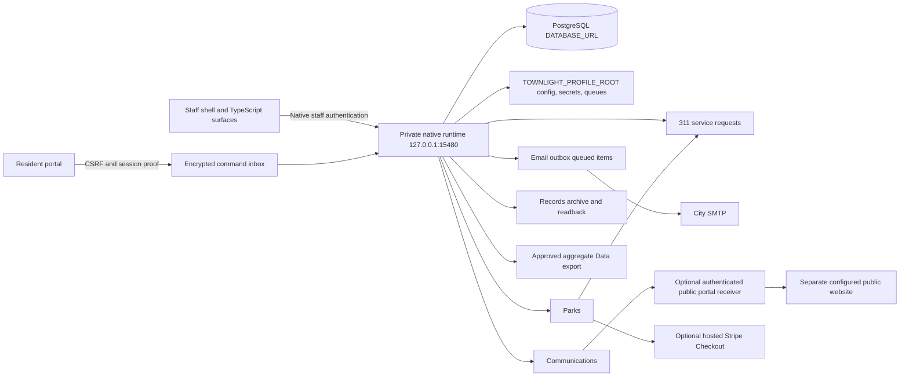
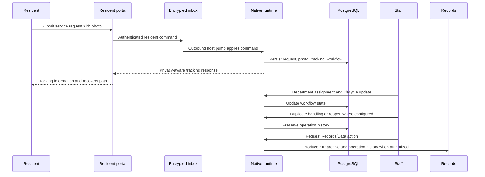
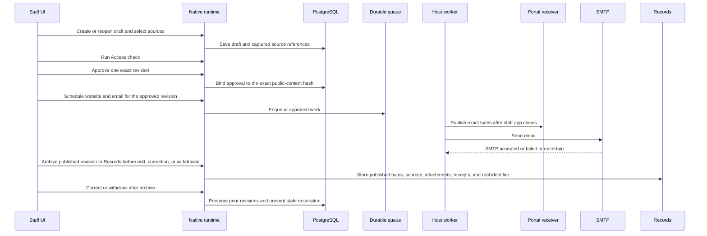
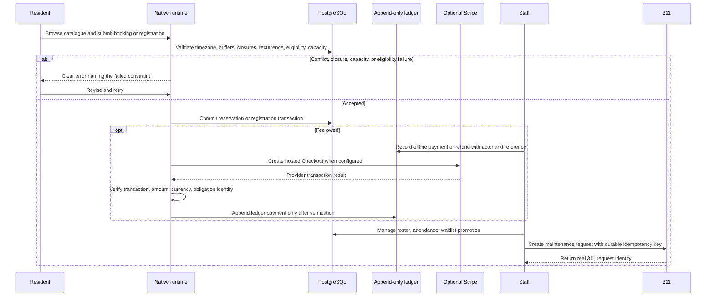
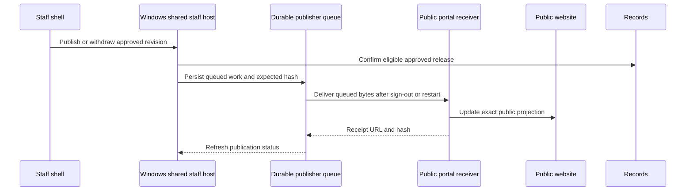

# Townlight 311, Communications, and Parks — Operator, Admin, and Integration Guide

## Status and scope

**Candidate identifier:** Windows `1.10.0.1`, runtime `0.4.0`.

This guide documents the current candidate for Townlight 311, Townlight Communications, and Townlight Parks. It is an operator, administrator, and integration reference for the supplied source tree and manuals. Target platform: Windows.

- The candidate is unpublished; no public download is available yet.
- The public Windows release `1.9.3.2` does not include these candidate modules.
- Source-level checks passed for this candidate. Installed acceptance and upgrade evidence remain pending.
- This document is not a release note, acceptance record, or marketing claim.
- Existing staff authentication and native session proof remain the access model.
- The manuals and source tree are the source of truth. Where a UI label, endpoint, or command is not present in the supplied material, this guide describes it as a configuration reference or integration question.

---

## 1. Roles and module access

The existing native roles are:

- `local-admin`
- `city-staff`
- `clerk`
- `records-staff`
- `code-staff`

The supplied role maps in `desktop/src-tauri/src/auth.rs` and `records/backend/townlight_records/auth/desktop_session.py` agree on module access.

| Role | Module access | Notes |
|---|---|---|
| `local-admin` | All profile modules | The source role map returns unrestricted access (`None`). This includes Records and Code when the active profile mounts them. The first Townlight admin uses this role. Administrative actions such as staff-user creation, disable/reactivate, and passcode reset are gated by the admin session check. |
| `city-staff` | All profile modules | The source role map returns unrestricted access (`None`). This includes Records and Code when the active profile mounts them. Day-to-day city work is still constrained by the installed profile and configured permissions. |
| `clerk` | `townlight_meetings`, `townlight_notice`, `townlight_access`, `townlight_311`, `townlight_comms`, `townlight_parks` | Clerk has 311, Communications, and Parks workflow access. Clerk does **not** have `townlight_records` or `townlight_code`, and the role map grants no Data receiving/export capability. |
| `records-staff` | `townlight_records` only | Records-only staff role. |
| `code-staff` | `townlight_code` only | Code-only staff role. |

`local-admin` and `city-staff` have all profile-module capabilities. `clerk` has the six modules listed above. `records-staff` has Records only. `code-staff` has Code only. Code is an existing role (`code-staff`), not an invented role.

### Workflow access versus Records/Data administrative capability

Module access is distinct from workflow use. Clerk can operate 311, Communications, and Parks workflows because those modules are present in Clerk’s mapping. That does not grant Clerk the Records module, the Code module, or Data receiving/export capability. A 311 request, Communications article, or Parks maintenance link does not by itself grant Records archive/read-back or Data export. Those capabilities follow the module map and the configured administrative surface.

Records archive/read-back is controlled by `townlight_records` module access. In the supplied role map, `local-admin`, `city-staff`, and `records-staff` have that module; Clerk and `code-staff` do not. Code is controlled by `townlight_code` module access; `local-admin`, `city-staff`, and `code-staff` have that module; Clerk and `records-staff` do not.

Staff-user creation in `auth.rs` accepts `city-staff`, `clerk`, `records-staff`, and `code-staff`. The first admin role is `local-admin`. Local staff sessions expire after 12 hours and are authenticated with an HMAC session hash stored in `local-session.json`. The runtime validates the current session, account state, role, expiry, passcode verifier, and per-install session key.

---

## 2. Architecture



The native runtime is private and binds to loopback only. The runtime host is `127.0.0.1`; the default runtime port is `15480`.

Residents submit through the resident portal into an encrypted command inbox. The outbound host pump applies authenticated resident commands. Durable command identities prevent replay-driven duplication. Queued work is not confirmed until the host applies it.

The public website path is optional and separately deployed. It requires a configured public portal, TLS, and publication/command credentials. The Windows application does not automatically publish a website or configure SMTP.

---

## 3. Core workflows

### 3.1 Townlight 311

#### Resident flow to staff lifecycle



Normal 311 behavior:

- Residents submit service requests through resident intake.
- Resident-facing tracking does not expose internal detail.
- The recovery flow is designed so staff never disclose another resident’s data.
- Staff follow the staff lifecycle and role assignments maintained by administrators.
- Clerk has 311 workflow access. Clerk does not receive Records or Data capability from the role map.
- `local-admin` and `city-staff` have all profile-module capabilities, including 311 and Records when mounted.
- Records are produced as ZIP archives that report the actual bytes written plus the operation history.

Failures and constraints:

- `DATABASE_URL` is required. The native runtime refuses to start without it.
- For profiles that require PostgreSQL, `DATABASE_URL` is a PostgreSQL URL.
- 311 migrations are required. In the supplied source, the runtime refuses to start 311 routes when `townlight_311` migrations are not applied.
- If the 311 module cannot import, `/health` reports the module error.
- Notification states are `sent`, `pending`, `failed`, and `uncertain`. Delivery is not guaranteed. `uncertain` means status is unknown after a send was attempted.
- SMTP setup is administrative. It is not implied by installing the candidate or enabling the public website.

Admin limits from the 311 manual:

- Attachments: **10 MiB** each.
- Import: CSV or JSON up to **2 MiB** and **1000 rows**, keyed by stable external IDs plus a source key, with an exact preview hash.
- Export: capped at **10,000 requests**. An export that would exceed the cap fails rather than truncating.
- Open311 support covers authenticated catalogue, read, and create with JSON/XML for the supported subset only. It is not full Open311 conformance.

#### 311 source and API pointers

- Windows route base: `/desktop/v1/service-requests`.
- Open311 route base: `/desktop/v1/service-requests/open311/...`.
- The old `townlight_311.main` module is a developer-only prototype helper API. It is not the Windows runtime and is not a complete standalone product.
- The resident-facing tracking, recovery, and staff lifecycle behavior described here comes from the 311 manual. Additional internal 311 routes or button labels are not invented in this guide.

---

### 3.2 Townlight Communications

#### Draft, exact-revision approval, scheduled publication, correction, and withdrawal



Normal Communications behavior:

- Create or reopen a draft.
- Select sources from the module sources exposed by the runtime. The supplied source includes a Parks source resolver.
- Save the draft and run an Access check.
- Review and approve one exact revision. Approval applies to that revision only. Later edits clear it.
- Schedule publication to the website and email for the approved revision.
- Publish, then archive the published revision to Records **before** editing, correcting, or withdrawing it.
- Corrections preserve prior revisions. Withdrawal prevents stale content from being restored.
- Captured approved source snapshots, public URLs, digests, and revision provenance remain with the article.
- Public attachments require review.
- Private source content cannot be published.
- Missing, private, or stale sources block approval.

Publication and delivery:

- The host configuration supplies the portal credential and origin.
- Normal operation uses an unattended host service, not an operator window, so scheduled work can complete after the staff app closes.
- Website tasks travel through the existing authenticated portal receiver, with receipt URL and hash retained.
- Email uses the city email settings shared with 311 SMTP.
- Subscribers must confirm their email address and can manage preferences or unsubscribe.
- `queued` means pending, not SMTP accepted.
- Only `sent` means SMTP accepted, not human receipt.
- `failed` and `uncertain` results are shown separately. An `uncertain` send is not retried automatically.
- Deterministic message identifiers and durable records support safe retries only when non-delivery is known.

Records:

- The Records archive stores the actual published bytes, source references, attachments, and receipts, and returns a real identifier.
- Records archive/read-back requires `townlight_records` module access. Clerk does not have that module; `local-admin`, `city-staff`, and `records-staff` do.
- Existing staff roles control drafting, review, and approval according to the module map.
- No resident account can see staff drafts or private source data.
- Publication metrics are limited to explicit approved aggregate reporting, not subscriber lists.

Failures and constraints:

- Communications migrations are required. In the supplied source, the runtime refuses to start Communications when `townlight_comms` migrations are not applied.
- Browser requests use a fixed native command allowlist and cannot choose arbitrary URLs.
- Portal inbound operations use encrypted authenticated inbox and pump patterns. The desktop service remains private.
- Production uses a real PostgreSQL schema with explicit migration. SQLite translation is for tests, and production bootstrap is false.
- Revisions are immutable and approval binds the exact public-content hash.
- Optimistic revisions and database transactions prevent two-PC lost updates.
- Plain text is stored and escaped paragraphs are rendered; HTML is not trusted.
- Source eligibility is checked at runtime against the owning module. User-supplied flags cannot authorize publication.
- The email outbox has durable state separate from 311. Subscriber tokens are hashed and private.
- The host service owns portal credentials and origin configuration.

#### Communications Parks source resolver

The Parks communications adapter is implemented in the supplied source at `desktop/runtime/python-services/townlight_runtime/communications_parks_sources.py`. It resolves Parks sources through the fixed internal application after native proof validation.

Supported source identifiers:

- `program:<uuid>`: fetches `/desktop/v1/parks/catalog/program/{program_id}` with `public_only=True`, requires a public snapshot, and builds a digest over `id`, `revision`, `title`, `description`, `timezone`, `min_age`, `max_age`, `eligibility_text`, and `accessibility`.
- `resource:<uuid>:closure:<uuid>`: fetches the public resource snapshot and `/desktop/v1/parks/resources/{resource_id}/closures`, selects the matching closure, normalizes `starts_at` and `ends_at` to UTC, and builds a digest over resource ID, name, address, timezone, closure ID, start, and end.

The resolver returns a reference with `kind: "parks"`, the original identifier, revision digest, title, public URL, SHA-256 digest, and `eligible: true`, plus the captured content. Invalid identifiers return `422`; ineligible sources return `404`; invalid source responses return `503`.

Source-level checks passed for this resolver. Installed behavior remains pending.

---

### 3.3 Townlight Parks

#### Catalogue, booking, payment, roster, and maintenance flow



Normal Parks behavior:

- Public facility and program catalogue and availability views.
- Booking and registration for residents.
- Session rosters, waitlists, promotion, and attendance.
- Household, participant, and minor data held privately.
- Fees, deposits, refunds, and reconciliation in integer cents with explicit currency.
- Offline payment and refund recording in an append-only ledger.
- Optional hosted Stripe Checkout adapter that verifies the provider transaction, amount, currency, and obligation identity at the host before any ledger record is created.
- Maintenance links that create real 311 requests with durable idempotency and returned 311 request identity.
- Explicitly approved Communications source snapshots.
- Records private ZIP archive/read-back and approved aggregate Data export according to module access.
- Notifications are recorded as queued items. **Queued is not delivered.**

Facility, program, and booking constraints:

- Each facility and program carries an explicit timezone. Hours are reviewed against that timezone before being shown publicly or used for availability.
- Daylight-saving transitions are reviewed explicitly. A stated local clock time may not map to a single UTC instant on a transition day.
- Facilities support setup and cleanup buffers. Buffers apply around a booking when availability is evaluated and when the reservation is locked.
- Closures and blackouts suppress availability for the affected windows and are evaluated in the facility’s timezone.
- A facility reservation may be single or recurring.
- The resource and session rows are locked in the same transaction as overlap checks and occupancy writes.
- Recurrence is applied all or nothing. A recurrence that would conflict as a whole is rejected as a whole, with no partial writes left behind.
- Locks are acquired in a stable order so concurrent requests do not deadlock.
- Conflicts produce a clear resident-facing error explaining which slot or constraint failed and how to revise the request.
- Reschedule and cancel use the same locking discipline as creation.
- A rejected or requested change names the constraint and a revision path. Retrying without a revision is expected to fail again.

Capacity and attendance constraints:

- Programs and sessions carry eligibility rules, including age ranges where configured, and a capacity.
- Registration is checked against eligibility and remaining capacity under the same transactional discipline used for facility reservations.
- When a session is full, a registration may be placed on a waitlist.
- Promotion from waitlist occurs against capacity with durable command identity, so a retried promotion is not duplicated. Promotion does not silently exceed capacity.
- Session rosters are private to permitted staff.
- Attendance check-in is idempotent. A repeated check-in for the same attendee and session does not create a second attendance record.
- Rosters and attendance are excluded from public pages and from aggregate Data exports containing participant detail.

Payments and refunds:

- Fee arithmetic is in integer cents with an explicit currency.
- Deposits and refunds are represented in integer cents with the session currency.
- Offline payments and refunds are recorded in an append-only ledger. Each entry carries the staff actor and a reference. Corrections are made by adding an opposite entry, not by editing history. Receipts are issued from ledger records.
- The hosted Stripe adapter is optional. In this source candidate no Stripe account is configured and no live charge is verified.
- When configured by an operator, the host creates a Checkout session for a specific obligation, the resident completes Checkout at the hosted provider, and the host retrieves the provider transaction and verifies transaction identity, amount, currency, and obligation identity against its own records. Only after that verification does the host append a ledger payment.
- Provider return URLs are not payment proof. A resident returning from a cancelled or interrupted Checkout is not evidence of payment.
- Card data does not enter Townlight; only provider identifiers and verified amounts are recorded.
- Ambiguous provider outcomes are reconciled before retry. Payment intents and refund intents persist across restart.

Maintenance and 311:

- Maintenance workflows create real 311 requests, not local placeholders.
- Each link carries a durable idempotency key so a retried submission does not create a duplicate 311 request.
- The recorded location and photo bytes are the actual submitted bytes.
- The returned 311 request identity is stored with the link so staff can track progress and resolution against the real request.
- Staff can view progress and resolution of a linked 311 request within the Parks surface. The 311 system is the source of truth for request lifecycle; Parks does not assert a status the 311 system has not returned.

Records, Data, and private attachments:

- Attachments are private.
- Records archive/read-back is a private ZIP path controlled by `townlight_records` module access.
- For archive review, rely on the exact content hash produced by the review step, not a filename or description.
- Aggregate Data export requires explicit approval. Approval records who approved the export and what aggregate scope was approved.
- Aggregate Data export excludes participant, contact, and accommodation details.
- Public pages never expose attachments, archive contents, archive hashes, household or participant data, accommodation notes, or private tracking identifiers.

Parks failures and constraints:

- Parks migrations are required. In the supplied source, the runtime refuses to start Parks when `townlight_parks` migrations are not applied.
- Production bootstrap is `False`. Tables are created only through explicit, programmatic migrations from the package migrations module. This guide does not invent migration command-line syntax.
- The optional hosted Stripe path is documented as when-configured. Live payment processing is not verified in this candidate.
- Notifications are queued. Queued is not delivered.

---

## 4. Optional public website and publication integration

The public website is optional and separate. It requires a separately configured public portal, TLS, and command inbox/publication credentials. The Windows application does not automatically publish a website and does not configure SMTP.



Rules for the optional website path:

- The public portal is separately deployed. The existing signed Windows installer is unchanged and does not install it.
- Website delivery is authenticated. The host uses `TOWNLIGHT_PUBLISHER_PUBLISH_ORIGIN` as the canonical website HTTPS origin.
- The Windows host uses `TOWNLIGHT_PORTAL_PUBLISHER_TOKEN_FILE` pointing to an absolute file containing a random 32-byte base64url token without padding.
- The website uses `TOWNLIGHT_PORTAL_PUBLISHER_TOKEN_SHA256_FILE` pointing to an absolute file containing the lowercase SHA-256 of the token text without its line terminator.
- Credential files are restricted to their service accounts.
- Serve `/townlight/v1/publications/` over the website’s canonical HTTPS origin and preserve its `Authorization` and `Content-Length` headers.
- For a city-issued certificate, install the issuing CA in the Windows trust store available to the publisher’s service identity and make sure the certificate covers the configured hostname.
- Allow upload bodies of the configured recording limit plus 2 MiB on this route and provision private disk accordingly.
- The worker and receiver read their credential files on each request. Rotate the matching files to replace the token, or remove the digest file to revoke delivery.
- Existing public pages stay visible until an authorized withdrawal reaches the website.

Portal TLS and deployment settings:

- Use a same-host TLS reverse proxy.
- Set `TOWNLIGHT_TRUST_TLS_PROXY=1` only when the proxy strips client forwarded headers, supplies its own HTTPS scheme, and sets the canonical `Host`.
- Set `TOWNLIGHT_DEBUG=0` for deployment.
- Set a unique `TOWNLIGHT_SECRET_KEY` of at least 50 characters.
- Set `TOWNLIGHT_ALLOWED_HOSTS`, HTTPS `TOWNLIGHT_BASE_URL`, HTTPS `TOWNLIGHT_CSRF_TRUSTED_ORIGINS`, and `TOWNLIGHT_STATIC_ROOT`.
- Run migrations and `collectstatic` for the separate portal as documented for the portal.
- The native desktop port and the private release directory remain private.
- Serve collected static assets only and proxy all other routes.

The portal uses these source-confirmed settings where applicable:

`TOWNLIGHT_SECRET_KEY`, `TOWNLIGHT_DEBUG`, `TOWNLIGHT_ALLOWED_HOSTS`, `TOWNLIGHT_CSRF_TRUSTED_ORIGINS`, `TOWNLIGHT_TRUST_TLS_PROXY`, `TOWNLIGHT_DB`, `TOWNLIGHT_STATIC_ROOT`, `TOWNLIGHT_MEDIA_ROOT`, `TOWNLIGHT_BRAND`, `TOWNLIGHT_BASE_URL`, `TOWNLIGHT_RELEASE_ROOT`.

These portal settings are not configured by the Windows candidate installer.

### Portal selection contract pointer

The portal lookup calls authenticated:

`GET /desktop/v1/portal/selections?request_id=<UUID>`

It returns:

```json
{"selections":[{"title":"<public archive title>","selection":{...}}]}
```

Each selection contains all publication fields with `approve_publication: false`. Selecting a choice sends `request_id`, `release_copy_id`, and `archive_id` as query parameters and fills the form. Both Meetings and Records permissions remain required.

The portal manual also documents an operator selection file for `python manage.py sync_townlight selection.json` with fields:

`action`, `approve_publication`, `archive_id`, `meeting_id`, `recording_id`, `request_id`, `release_copy_id`, `expected_release_sha256`.

Those identifiers are placeholders in the example. A prepared release copy alone is not public; separate explicit approval authorizes export.

---

## 5. Configuration reference

Only environment names present in the supplied source or manuals are listed. This is a configuration reference, not an installation script. Secret values are kept out of this guide.

### Native runtime

| Name | Purpose and constraints |
|---|---|
| `TOWNLIGHT_PRODUCT_PROFILE` | Selects the product profile. Default in source is `records-beta`. In the supplied source, the 311, Communications, and Parks routers/repositories are wired under the `inspections-preview` profile. Other profile values are defined in source. |
| `DATABASE_URL` | Required. The runtime refuses to start without it. Profiles that require PostgreSQL enforce a PostgreSQL URL. |
| `TOWNLIGHT_PROFILE_ROOT` | Absolute profile root. Used for config, secrets, queues, and related private state. |
| `TOWNLIGHT_DATA_DIR` | Alternative data directory input from source. The profile root defaults to its parent when used. |
| `TOWNLIGHT_RUNTIME_HOST` | Must remain `127.0.0.1`. The runtime raises if another host is set. |
| `TOWNLIGHT_RUNTIME_PORT` | Native runtime port. Default `15480`. |
| `TOWNLIGHT_SHARED_STAFF_HOST` | Set to `1` to install shared staff routing and start the host workers described in source. Without it, unattended host work is not started. |
| `TOWNLIGHT_PUBLISHER_PUBLISH_ORIGIN` | Canonical website HTTPS origin used by host publication and related workers. Required for the Communications host, resident command pump, and Parks email/catalog work as shown in source. |
| `JWT_SECRET_FILE` | Secret file path set by the runtime when local secrets are initialized. |
| `FIRST_ADMIN_PASSWORD_FILE` | Secret file path set by the runtime when local secrets are initialized. |
| `ENCRYPTION_KEY` | Runtime-held encryption key value/file reference set by the runtime. |
| `TOWNLIGHT_CODE_SOURCE_REGISTRY_DB_URL` | Set by the runtime from `DATABASE_URL` for the relevant city-core-style profiles. Code readiness uses it. |
| `TOWNLIGHT_PORTAL_PUBLISHER_TOKEN_FILE` | Windows-host credential file for portal publication. Restricted absolute file. |
| `TOWNLIGHT_PORTAL_PUBLISHER_TOKEN_SHA256_FILE` | Website-side digest file for the matching portal publication token. Restricted absolute file. |
| `TOWNLIGHT_NATIVE_ORIGIN` | Trusted private native runtime origin for the separate portal bridge. HTTPS or loopback HTTP as documented. |
| `TOWNLIGHT_NATIVE_PROOF_FILE` | Absolute server-only file containing the native session proof. The proof is not sent to the browser. Restricted to the portal service account. Refresh after session expiry, sign-out, account change, or credential change. |
| `TOWNLIGHT_DISPLAY_TIMEZONE` | Optional IANA display timezone for the portal bridge. Default `UTC`. |
| `TOWNLIGHT_PORTAL_MAX_BYTES` | Portal transport maximum. Default 8 GiB, upper bound 64 GiB. This is not the end-to-end recording limit. |

Source defaults also include `PORTAL_MODE`, `OLLAMA_BASE_URL`, `TOWNLIGHT_MEETINGS_OLLAMA_BASE_URL`, and `TOWNLIGHT_CORE_LLM_PROVIDER`. These are configuration references only.

### Records, Code, and portal restrictions

- Records archive/read-back uses `townlight_records` module access.
- Code uses `townlight_code` module access and is profile-dependent.
- The public portal is separate from the native runtime. It requires its own TLS configuration, publication credentials, and command inbox/publication setup.
- SMTP settings are administrative. MSI installation, native startup, and website publication do not configure SMTP automatically.

---

## 6. API and native JSON contract pointers

### Runtime health

Source pointer: `desktop/runtime/python-services/townlight_runtime/services.py`.

- `GET /health` and `GET /modules` return the same runtime health payload. Status is `200` only when the payload status is `ok`; otherwise `503`.
- Payload fields include:
  - `status`: `ok` or `degraded`
  - `service`: `townlight-runtime`
  - `version`
  - `product_profile`
  - `modules`: entries with `id`, `ok`, `import`, and either `version` or `error`
  - `database`: `ok`, `status`, and `message`
  - `local_only`: `true`
- Database status values include `missing`, `unavailable`, `ready`, and `migrations-needed`.
- `GET /ready` returns `{"status":"ready"|"not-ready","reason":"..."}` with `200` or `503`.
- A `domain-inactive` readiness reason means the domain application is not active.
- Domain readiness checks schema readiness for the mounted modules. For Code and other restricted modules, readiness may report a specific schema-unavailable reason.

### 311

- Windows route base: `/desktop/v1/service-requests`.
- Open311 route base: `/desktop/v1/service-requests/open311/...`.
- Open311 support is authenticated catalogue, read, and create for the supported JSON/XML subset. It is not full Open311 conformance.
- Resident-facing tracking is privacy-aware. Internal detail is not exposed.
- Recovery is designed so staff never disclose another resident’s data.
- 311 import preview, CSV/JSON limits, export cap, and notification statuses are as stated in Section 3.1.

### Communications

- Desktop route base: `/desktop/v1/communications`.
- Protected by native staff authentication.
- Browser requests use a fixed native command allowlist and cannot choose arbitrary URLs.
- Revisions are immutable and approval binds the exact public-content hash.
- The supplied Parks resolver handles `program:<uuid>` and `resource:<uuid>:closure:<uuid>` source identifiers as described in Section 3.2.
- Exact JSON field lists for every Communications command are not reproduced in the supplied material. Use the source contract and the staff UI.

### Parks

- Source-confirmed Parks routes used by the Communications resolver:
  - `GET /desktop/v1/parks/catalog/program/{program_id}` with `public_only=True`
  - `GET /desktop/v1/parks/catalog/resource/{resource_id}` with `public_only=True`
  - `GET /desktop/v1/parks/resources/{resource_id}/closures`
- The supplied manuals describe public catalogue and availability responses, private staff workflows, and native bridges. They do not publish a complete Parks HTTP endpoint list.
- Public pages expose catalogue and availability only. They do not expose household, participant, minor, accommodation, contact, attachment, or private tracking details.
- Parks maintenance uses durable idempotency and returns a real 311 request identity.

### Portal selection and publication

- `GET /desktop/v1/portal/selections?request_id=<UUID>` returns the selection JSON shape in Section 4.
- Both Meetings and Records permissions are required for that cross-module selection workflow.
- Portal publication uses `/townlight/v1/publications/` on the separate website origin.
- A failed sync leaves the previous publication intact. Repeating a successful sync updates the same archive identity.

---

## 7. Backup, restore, and upgrade references

Back up the database, private files, and keys as a related unit. A database-only backup is incomplete.

| Component | What to preserve |
|---|---|
| Native database | The database selected by `DATABASE_URL`, including workflow, audit, ledger, outbox, and queue-related schemas. |
| Native profile | `TOWNLIGHT_PROFILE_ROOT`, including `config/secrets`, local session state, publisher queue state, and any profile-backed payment or email settings. |
| Records and attachments | Records archives, private managed files, Parks attachments, Communications attachments, 311 photo bytes, and archive/read-back data. |
| Communications and Parks outboxes | Durable queue work, email outbox state, publisher queue work, and reconciliation state. |
| Portal | The portal database selected by `TOWNLIGHT_DB`, `TOWNLIGHT_MEDIA_ROOT`, and `TOWNLIGHT_RELEASE_ROOT`. |
| Credentials | Portal proof files, publisher token files, token digest files, and native profile secrets. Restricted and protected. |

Restore preserves the relationship between durable command identities, ledger entries, queued work, publication state, and Records archives.

- After restart, the runtime reopens durable requests and resumes known-safe jobs without duplicates.
- A resumed job is not evidence of delivery or provider settlement until the host re-verifies.
- Payment intents and refund intents persist across restart.
- Ambiguous provider outcomes are reconciled before retry.
- If restoring to an earlier host queue, reconcile its state against the website before sending further revisions.
- Upgrade evidence for the candidate is pending. The installed candidate has not been validated for upgrade preservation, migration, or rollback.

---

## 8. Troubleshooting

| Symptom | Source-supported cause and response |
|---|---|
| Runtime fails with `DATABASE_URL must be configured` | Configure `DATABASE_URL`. Start through the Townlight supervisor or provide the explicit PostgreSQL URL expected by the profile. |
| Runtime reports PostgreSQL required | The selected profile requires a PostgreSQL `DATABASE_URL`. |
| Runtime fails with unsupported product profile | Use a profile defined in source. |
| `/health` reports `degraded` with module import error | A required module failed to import. Check that the deployed package set matches the candidate and profile. |
| `/health` database status is `migrations-needed` | The database is reachable but the task-queue schema is not ready. Apply the explicit migrations for the deployed package set. This guide does not invent a migration CLI. |
| `/ready` returns `not-ready` with `domain-inactive` | The domain application is not active. Verify activation state for the profile and database before expecting domain routes to serve. |
| 311, Communications, or Parks refuses to start | Check the corresponding package migrations. The supplied source refuses to start service requests, Communications, or Parks when their migrations are not ready. |
| Code readiness reports a Code schema problem | Check the Code source-registry readiness and the profile. `code-staff` is the Code-only role; `local-admin` and `city-staff` also have Code when the profile mounts it. |
| Email state stays `queued` | Queued is pending, not SMTP accepted. The host worker must apply the work. Verify `TOWNLIGHT_SHARED_STAFF_HOST=1` and the relevant host configuration. |
| Email state is `uncertain` | Status is unknown after a send was attempted. Reconcile with the mail path and durable outbox state. |
| Website publication stays queued or retrying | The website has not confirmed the action. The host delivers queued copies and withdrawals after staff sign out. Refresh the meeting/publication status before treating a copy or withdrawal as live. |
| Portal publication credentials fail | Verify the Windows token file, website digest file, canonical HTTPS origin, TLS trust, and header preservation on `/townlight/v1/publications/`. Rotate the matching files to replace the token; remove the digest file to revoke delivery. |
| Resident command pump or Communications host does not start | Check `TOWNLIGHT_SHARED_STAFF_HOST=1` and `TOWNLIGHT_PUBLISHER_PUBLISH_ORIGIN`, plus the required repository and email settings shown in source. |
| Parks payment stays ambiguous | Provider return URLs are not payment proof. Verify the provider transaction, amount, currency, and obligation identity. Reconcile before retry. No live charge is verified in this candidate. |
| Parks waitlist promotion or attendance retried | Durable command identity and idempotent check-in prevent duplicates. If the result is unclear, inspect durable state rather than repeating the action. |
| Shutdown reports a worker did not stop cleanly | The runtime raises after attempting to stop product threads. Restart after checking durable queue and provider state. A resumed job is not delivery evidence. |

---

## 9. Acceptance and factual notes

- **Installed acceptance is pending.** Source-level checks passed; installed behavior remains pending.
- **Upgrade evidence is pending.** Upgrade preservation, migration, and rollback are not demonstrated for this candidate.
- **Public release exclusion:** Windows release `1.9.3.2` does not include these candidate modules.
- **No public download yet:** Windows `1.10.0.1` / runtime `0.4.0` is an unpublished candidate.
- **No automatic website or SMTP claim:** The Windows application does not automatically publish a website and does not configure SMTP. The public portal is a separate configured deployment.
- **No live Stripe claim:** The hosted Stripe adapter is optional and no live charge is verified in this candidate.
- **Communications Parks source adapter:** The supplied source implements the Parks source resolver. Source-level checks passed; installed verification is pending.
- **Parks HTTP contract:** A complete Parks HTTP endpoint list is not present in the supplied material. The source-confirmed routes used by the Communications resolver are listed in Section 6.
- **Migration syntax:** Parks migrations are programmatic. This guide does not invent command-line syntax for migrations.
- **Role matrix:** `local-admin` and `city-staff` have all profile-module capabilities; `clerk` has Meetings/Notice/Access/311/Communications/Parks and no Records/Code/Data capability; `records-staff` has Records only; `code-staff` has Code only.
- **Windows target:** This guide covers the Windows candidate.

This document describes the current candidate state only. It is not an acceptance record and does not establish installed, signed, released, or upgraded status.
